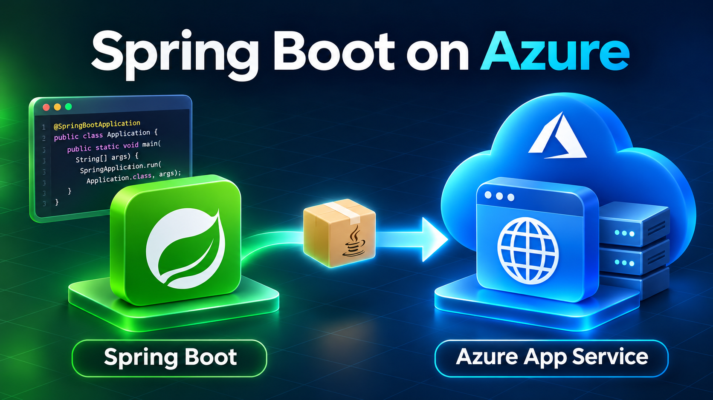

---

layout: post  
title: "Deploy a Spring Boot Application on Azure App Service (With the Maven Plugin)"  
categories: [java,cloud]

---



## Overview

Hey there! 👋

If you've built a Spring Boot app and you're now wondering *"okay, how do I actually put this thing online?"*, this post is for you. We're going to take a small, real project — **Person Manager** — and deploy it to **Azure App Service** using the Azure Maven plugin.

Let's go!

## 1. What is Azure App Service, anyway?

Think of **Azure App Service** as a fully managed "box" where you can drop your application and Azure takes care of everything around it: the operating system, the web server, scaling, SSL certificates, monitoring... all the boring-but-necessary stuff you don't want to manage yourself.

It's a **Platform as a Service (PaaS)** offering, which means:

- ✅ You don't manage servers or patch operating systems.
- ✅ You get built-in support for Java, .NET, Node.js, Python, PHP, and more.
- ✅ You can scale up (bigger machine) or scale out (more instances) with a few clicks or a CLI command.
- ✅ Deployment slots let you test in a staging environment before swapping to production — zero downtime.
- ✅ Built-in HTTPS, custom domains, authentication, and integration with Azure Monitor / Application Insights.
- ✅ It supports both **code deployments** (like our Spring Boot JAR) and **container deployments** (Docker images).

**In short**: _you focus on your code and Azure focuses on keeping it running. That's the whole pitch of Platform as a Service (PaaS), and for a Spring Boot REST API like ours, it's a great fit we don't need Kubernetes-level complexity for a simple app_.


## 2. The project: Person Manager

We are still using the same [project](https://github.com/HattoriHenzo/person-azure-app-service). **Person Manager** is a small Spring Boot REST API that manages... people! (Surprise...), but seriously it simply manage your contacts. It lets you create, read, update, and delete person records (first name, last name, birthday, phone number, email). We will not spend time on how this application is implemented, you can download the source from GitHub.


## 3. Deploying with the Azure Maven Plugin

Microsoft provides an official Maven plugin,  `azure-webapp-maven-plugin`, that can **provision** the Azure App Service *and* **deploy** your JAR to it, all using your `pom.xml`.

### Step 1 — Log in to Azure

Before anything else, authenticate your machine to Azure using [Azure CLI](https://learn.microsoft.com/en-us/cli/azure/install-azure-cli?view=azure-cli-latest):

```bash
az login
```

(Or `mvn com.microsoft.azure:azure-webapp-maven-plugin:1.18.0:config` if you prefer the plugin's interactive wizard more on that below.)

### Step 2 — Add the plugin to `pom.xml`

```xml
<plugin>
    <groupId>com.microsoft.azure</groupId>
    <artifactId>azure-webapp-maven-plugin</artifactId>
    <version>2.14.1</version>
    <configuration>
        <schemaVersion>v2</schemaVersion>
        <resourceGroup>rg-person-manager</resourceGroup>
        <appName>person-manager-app</appName>
        <pricingTier>B1</pricingTier>
        <region>westus/region>
        <runtime>
            <os>Linux</os>
            <webContainer>Java SE</webContainer>
            <javaVersion>Java 21</javaVersion>
        </runtime>
        <deployment>
            <resources>
                <resource>
                    <directory>${project.basedir}/target</directory>
                    <includes>
                        <include>*.jar</include>
                    </includes>
                </resource>
            </resources>
        </deployment>
    </configuration>
</plugin>
```

A quick breakdown of what matters here:

- `resourceGroup` / `appName` — where and under what name your app lives in Azure.
- `pricingTier` — `B1` is a cheap, basic tier, perfect for a demo. Bump it up for production traffic.
- `runtime` — tells Azure this is a plain Java SE app (not a WAR on Tomcat), running on Linux with Java 21.
- `deployment.resources` — tells the plugin *what to ship*: the fat JAR produced by `spring-boot-maven-plugin`.

You will have to adapt those information depending on your use case.

💡 **Tip:** You don't have to write this by hand. Run `mvn com.microsoft.azure:azure-webapp-maven-plugin:2.14.1:config` and answer a few prompts (resource group, region, pricing tier, runtime) — the plugin generates this configuration for you. You can check the GitHub link [here](https://github.com/microsoft/azure-maven-plugins/blob/develop/azure-webapp-maven-plugin/README.md).

### Step 3 — Package the application

```bash
./mvnw clean package
```

This produces `target/person-manager-0.0.1-SNAPSHOT.jar` — our deployable artifact.

_For deployment in production your package name should not have SNAPSHOT in its name it used for development purpose_.

### Step 4 — Deploy

```bash
./mvnw azure-webapp:deploy
```

That single command will:
1. Create the App Service plan and Web App if they don't exist yet.
2. Upload your JAR.
3. Restart the app service and start your Spring Boot application.

Once it's done, you'll see a URL in the console output, something like. Depending on the name of your instance you will have a link to access to API exposed by your Controllers:

```
https://your-application-name.azurewebsites.net
```

Hit it with a request:

```bash
curl https://your-application-name.azurewebsites.net/persons
```

Or in the Azure App Sercice console, you can click on the link of the application and look for the **Default domain**.

And there you go — your Spring Boot API, live on Azure. 🎉

### A couple of practical notes before going to production

- **Port binding**: App Service expects your app to listen on the port provided via the `PORT` environment variable (or `WEBSITES_PORT` app setting). Spring Boot defaults to `8080`, which App Service also defaults to — so usually it just works out of the box, but keep it in mind if you customize things.
- **Secrets**: don't hardcode database credentials in `application.yaml`. Use App Service's **Application Settings** (environment variables) or **Azure Key Vault** references instead.


## 4. Other ways to deploy to Azure App Service

The Maven plugin is great for a Java-first, CLI-driven workflow, but it's not the only door in. Depending on your team and your pipeline, here are the other common options:

### 🔹 Azure CLI
Zip up your JAR and push it directly:
```bash
az webapp deploy --resource-group rg-person-manager --name person-manager-app --src-path target/person-manager-0.0.1-SNAPSHOT.jar --type jar
```
Great for scripts and automation outside of Maven.

### 🔹 GitHub Actions / Azure DevOps Pipelines
Both have native **Deploy to Azure Web App** tasks/actions. You build your JAR as part of your CI pipeline, then a dedicated step pushes it to App Service using a publish profile or OIDC-based federated credentials. This is the most common approach for real teams build, test, and deploy automatically on every merge to `main`.

### 🔹 Visual Studio Code — Azure App Service extension
If you like staying in your editor, install the **Azure App Service** extension for VS Code. Right-click your JAR (or folder) → **Deploy to Web App**. Perfect for quick demos or solo projects.

### 🔹 Docker container deployment
Package your Spring Boot app into a Docker image and deploy it as a **Web App for Containers**. This gives you full control over the runtime environment (custom JDK versions, native libraries, etc.) and works well if you're already using containers elsewhere in your stack.

### 🔹 Infrastructure as Code (Bicep / Terraform)
For production-grade setups, you'll likely want your App Service resource defined in **Bicep** or **Terraform**, version-controlled alongside your app. The deployment of the *code* can still use the Maven plugin or CI/CD pipeline — but the *infrastructure* (App Service plan, networking, scaling rules) is managed declaratively.


## Conclusion

Deploying a Spring Boot app to Azure App Service doesn't have to be complicated. For a project like Person Manager, the Maven plugin gets you from `mvn package` to a live public URL in just two commands. As your app grows, you can layer in CI/CD, container deployments, or infrastructure-as-code — but the core idea stays the same: build your JAR, tell Azure where it goes, and let App Service handle the rest.

Happy shipping! 🚀

### Some useful links

1. The source code is available on [GitHub](https://github.com/HattoriHenzo/person-azure-app-service).
2. [Azure Maven Plugin](https://github.com/microsoft/azure-maven-plugins)
